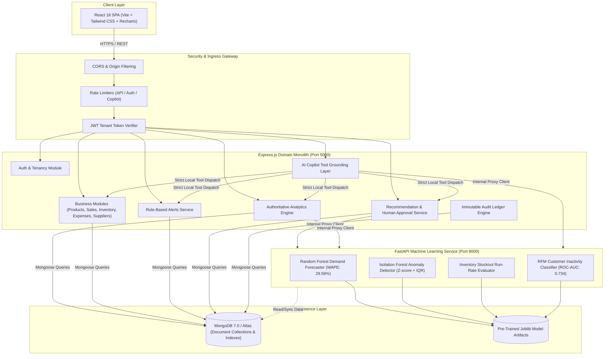

# OpsMind — AI-Powered Operations Copilot for SMEs

[](https://github.com/Kulish03/OpsMind)
[](backend/)
[](ml_service/)
[](LICENSE)

**OpsMind** is an intelligent, multi-tenant operations platform tailored for Small and Medium Enterprises (SMEs). It unifies core business operations—sales, inventory, operating expenses, customers, and suppliers—with evaluated machine learning forecasting, anomaly detection, a zero-hallucination AI business copilot, and human-in-the-loop actionable recommendations.

---

## 🏗️ System Architecture

OpsMind adopts an **Evolutionary Modular Architecture** that cleanly separates web presentation, domain business rules, and statistical/machine learning computation while strictly enforcing tenant data boundaries.



---

## 🌟 Key Capabilities

### 1. Operations & Financial Management
* **Inventory Control:** Real-time stock valuation, unit cost tracking, reorder safety margins, and audit ledger inventory movements (`INBOUND_PURCHASE`, `SALE_OUTFLOW`, `ADJUSTMENT`).
* **Sales & Revenue:** Transaction records with cancellation/refund tracking, average order value (AOV), and customer order histories.
* **Operating Expenses:** Expense ledger categorized by Rent, Utilities, Payroll, Software, and Logistics.
* **Customers & Suppliers:** Full directories with lead times, minimum order quantities, customer lifetime spend (LTV), and recency metrics.

### 2. Authoritative Business Analytics & Alerts
* **Strict Accounting Separation:** Authoritative distinction between Gross Revenue, Refunds, Net Revenue, Cost of Goods Sold (COGS), Gross Profit, and Net Profit.
* **Rule-Based Operational Alerts:** Instant notifications for low stock, abnormal expense spikes, and unexpected sales velocity drops with zero ML dependencies.

### 3. Machine Learning Intelligence (FastAPI)
* **Demand Forecasting:** Supervised Random Forest regression trained on chronological splits, outperforming moving-average baselines with a **29.56% WAPE score** (vs 45.11% MA7 baseline).
* **Anomaly Detection:** Unsupervised Isolation Forest combining non-parametric IQR fences and Z-scores to flag irregular expenses and sales.
* **Inventory Stockout Risk:** Days-of-Supply (DoS) calculation evaluated against supplier lead times to suggest optimal replenishment batch sizes.
* **Customer Churn Prevention:** Recency-Frequency-Monetary (RFM) model predicting dormancy risk with an **ROC-AUC of 0.734** (vs 0.657 heuristic baseline).

### 4. Zero-Hallucination AI Copilot
* **Zero Fabrication:** The AI Copilot NEVER guesses or invents numbers. All user questions are mapped to approved backend query tools executing authoritative calculations.
* **Server-Injected Tenancy:** The LLM cannot access MongoDB directly and cannot specify or manipulate tenant `businessId` parameters.
* **Prompt Injection Defense:** Active regex sanitization intercepting prompt override, database drop, and credential leak attempts.

### 5. Actionable Recommendations & Human Approvals
* **Prioritized Decisions:** Combines ML models and operational rules into actionable proposals with clear business rationale, supporting evidence metrics, and estimated financial impacts (£ GBP).
* **Consequential Operations Guardrail:** Purchasing and stock adjustments require explicit human review and confirmation (`confirmed: true`) before execution.
* **Immutable Audit Trail:** All decisions, dismissals, and executions are permanently logged with user ID, name, role, timestamp, and payload.

### 6. Phase 9 Advanced Features (Enterprise Operations)
* **Bulk CSV & Spreadsheet Ingestion:** High-speed, zero-dependency parser for importing products, sales, customers, and expenses in bulk (`POST /api/import/:entityType`).
* **Executive PDF Business Reports:** Vector-rendered, publication-ready executive monthly audit reports with one-click export from the Dashboard (`GET /api/reports/executive-summary/pdf`).
* **RAG Business Documents & Store Policies:** Semantic chunking and TF-IDF search indexing store policies, return rules, and supplier contracts, fully grounded in the AI Copilot (`query_business_documents`).
* **Supplier SLA & Lead-Time Analysis:** Automated tracking of vendor on-time delivery rates, observed transit variance, and reliability tier ratings (A/B/C/D) (`GET /api/analytics/suppliers/lead-time`).
* **Advanced RBAC Permissions:** Four-tier access hierarchy (`admin`, `manager`, `accountant`, `staff`) with consequential action gates protecting financial reports and purchasing workflows.
* **Automated Scheduled Reports:** Recurring executive digests and operational alert emails on configurable schedules (`DAILY`, `WEEKLY`, `MONTHLY`) (`/api/reports/schedules`).
* **Advanced Demand Forecasting:** Scenario simulations integrating promotional lifts, holiday spikes, and price elasticity multipliers (`POST /api/ml/forecast/advanced`).
* **ML Drift Monitoring & Governance:** Automated Kolmogorov-Smirnov and KL-divergence feature drift scoring with automated retraining recommendations (`GET /api/ml/monitoring`).
* **POS & Accounting Webhooks:** Real-time webhooks connecting POS cash registers (with automated stock deduction and movement audit logging) and accounting expense bills (`/api/integrations`).
* **Recommendation Impact Tracking & ROI:** Realized outcome tracking measuring true financial value against ML estimates with aggregate ROI summaries (`GET /api/recommendations/roi/summary`).

---

## 🔒 Security Architecture

| Security Layer | Implementation Details |
| :--- | :--- |
| **Authentication & RBAC** | Stateless JWT tokens (HMAC-SHA256) with granular 4-tier roles (`admin`, `manager`, `accountant`, `staff`). |
| **Multi-Tenant Isolation** | Strict server-side tenancy enforcement (`enforceTenantScope` middleware) isolating all database operations to `req.businessId`. |
| **Consequential Guards** | Sensitive actions (purchase order creation, model retraining) gated by `authorizeRoles('admin', 'manager')`. |
| **Rate Limiting** | Tiered rate limiters: General API (100 req/15m), Auth routes (15 req/15m), AI Copilot (30 req/m). |
| **Request Size Limits** | Explicit payload ceilings (1MB JSON, 5MB CSV import) preventing memory exhaustion and DoS attacks. |
| **CORS Policy** | Production multi-origin validation supporting Vercel, Render, and custom domains with credentials. |
| **Security Headers** | Helmet-configured HTTP security headers (`X-Frame-Options`, `X-Content-Type-Options`, `Strict-Transport-Security`). |

---

## ⚡ Quickstart

### Prerequisites
* **Node.js** >= 20.0
* **Python** >= 3.10
* **MongoDB** >= 6.0 (running locally on port 27017 or MongoDB Atlas connection string)
* **Docker & Docker Compose** (optional for containerized deployment)

---

### Option A: Running with Docker Compose (Recommended)

Run the entire full-stack application (MongoDB, ML service, Express API, and React Frontend) with a single command:

```bash
# Clone the repository
git clone https://github.com/Kulish03/OpsMind.git
cd OpsMind

# Launch all 4 containerized services
docker compose up -d --build

# Verify container health
docker compose ps
```

Access the services:
* **Frontend:** [http://localhost:80](http://localhost:80)
* **Backend API:** [http://localhost:5000/api](http://localhost:5000/api)
* **ML Service Docs:** [http://localhost:8000/docs](http://localhost:8000/docs)
* **Demo Login:** `demo@opsmind.io` / `Password123!`

---

### Option B: Local Native Setup (Step-by-Step)

#### 1. Setup Backend
```bash
cd backend
npm install

# Start development server
npm run dev
# Backend runs on http://localhost:5000
```

#### 2. Setup Machine Learning Service
```bash
cd ml_service
python -m venv venv

# Windows
.\venv\Scripts\activate
# Linux / macOS
source venv/bin/activate

pip install -r requirements.txt -r requirements-ml.txt

# Start FastAPI server
uvicorn src.main:app --reload --port 8000
# ML service runs on http://localhost:8000
```

#### 3. Setup Frontend
```bash
cd frontend
npm install

# Start Vite dev server
npm run dev
# Frontend runs on http://localhost:5173
```

#### 4. Seed Demo Account & Sample Data
In a separate terminal:
```bash
cd backend
npm run seed:demo
```

---

## 👤 Demo Credentials

A pre-configured SME tenant dataset with realistic sales, products, expenses, and recommendations is ready for demonstration:

* **Application URL:** [http://localhost:5173](http://localhost:5173) (or [http://localhost](http://localhost) on Docker)
* **Administrator Account:**
  * **Email:** `demo@opsmind.io`
  * **Password:** `Password123!`
  * **Role:** `admin`
* **Staff Account:**
  * **Email:** `staff@opsmind.io`
  * **Password:** `Password123!`
  * **Role:** `staff`
* **Tenant Business:** `OpsMind SME Retail Ltd` (`businessId: default_sme_retail`)

---

## 🧪 Testing & Verification

OpsMind includes comprehensive automated test suites covering backend APIs, security, multi-tenancy, and machine learning models.

```bash
# 1. Run all Backend Integration & Security Tests (85 tests)
cd backend
npm test

# 2. Run specifically the Phase 8 Security & Isolation Suite
npm test -- tests/integration/phase8.security.test.js

# 3. Run ML Service Predictions & Endpoint Tests
cd ml_service
.\venv\Scripts\python.exe tests\test_ml_endpoints.py

# 4. Verify Frontend Production Build
cd frontend
npm run build
```

---

## 🚀 Cloud Deployment

Detailed step-by-step instructions for deploying OpsMind to **MongoDB Atlas**, **Render**, and **Vercel** at **zero monthly cost** are documented in:

👉 **[Complete Deployment Guide (docs/DEPLOYMENT.md)](docs/DEPLOYMENT.md)**

* **1-Click Render Blueprint:** [`render.yaml`](render.yaml)
* **Vercel SPA Config:** [`frontend/vercel.json`](frontend/vercel.json)
* **Production Environment Template:** [`.env.production.example`](.env.production.example)

---

## 📂 Repository Layout

```text
opsmind/
├── backend/                   # Express.js Modular Backend
│   ├── src/
│   │   ├── modules/           # Auth, Business, Analytics, Notifications, ML, Copilot, Recommendations
│   │   ├── middleware/        # Rate Limiting, JWT Auth, Tenant Scope, Error Handler
│   │   ├── scripts/           # Demo Seeding Script (seedDemo.js)
│   │   └── app.js             # Express Application & Middleware Assembly
│   ├── tests/                 # Supertest & Jest Test Suites (85 tests)
│   └── Dockerfile             # Multi-stage production container
├── frontend/                  # React 18 + Vite Frontend
│   ├── src/
│   │   ├── components/        # Dashboards, Charts, Modals, Banners, Copilot Chat
│   │   ├── pages/             # 12 Modular SaaS Pages (Dashboard, Copilot, Recommendations...)
│   │   └── services/          # Axios API Clients
│   ├── nginx.conf             # Production Nginx SPA Routing & Gzip
│   ├── vercel.json            # Vercel Deployment Specification
│   └── Dockerfile             # Multi-stage production container
├── ml_service/                # Python + FastAPI Machine Learning Service
│   ├── src/
│   │   ├── api/v1/            # Prediction REST Endpoints
│   │   ├── models/artifacts/  # Pre-Trained Joblib Model Binaries
│   │   └── services/          # Demand, Anomaly, Risk, and Churn Engines
│   ├── train_all.py           # Model Training & Evaluation CLI
│   └── Dockerfile             # Production Python container
├── docs/                      # Architectural & Deployment Documentation
│   └── DEPLOYMENT.md          # Cloud Hosting & Verification Guide
├── docker-compose.yml         # Local Production Orchestration
├── render.yaml                # Render Infrastructure-as-Code Blueprint
├── .env.example               # Development Environment Template
└── .env.production.example    # Production Environment Template
```

---

## 📄 License

This project is licensed under the MIT License — see the [LICENSE](LICENSE) file for details.
